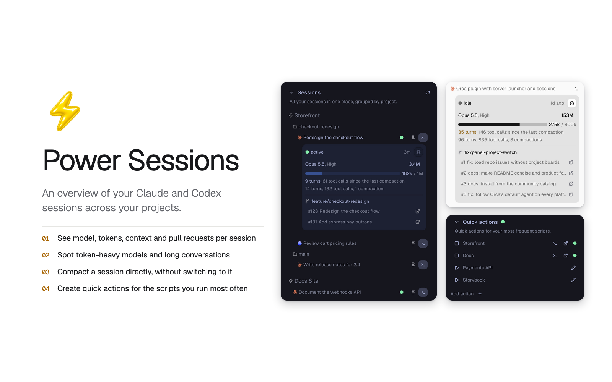
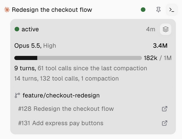
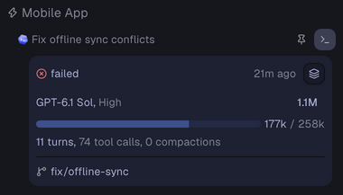
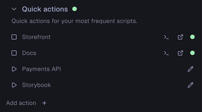
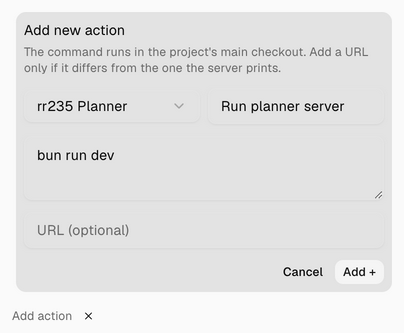

# Power Sessions

See every Claude and Codex session across your Orca projects in one side panel. Check what each
agent is doing and how much it has used, compact a long terminal session, and run your dev scripts.



## Features

- **See every session.** Claude and Codex sessions, grouped by project. A green dot marks an agent that is working.
- **Check a session at a glance.** Status, model and reasoning effort, tokens, context, turns, tool calls and compactions, where available.
- **Recognise model and turn warnings.** Fable and Astra model names show in the warning colour, as do long conversations.
- **Follow the work.** Session details show the workspace branch and linked pull requests, which open in your browser.
- **Compact in one press.** Compact a terminal session without switching to it.
- **Jump to a session.** Open a terminal session’s tab, or a chat’s workspace, straight from the list.
- **Run your scripts.** Quick actions start and stop a dev server, show its terminal and open its URL.

| Session details | Compact |
| --- | --- |
|  |  |

| Quick actions | Add an action |
| --- | --- |
|  |  |

More screenshots, in dark and light: [docs/features.md](docs/features.md).

## Get started

Requires **Orca 1.4.268+** with its CLI, on macOS. Pull request titles need **GitHub CLI (`gh`)**,
signed in with access to your repositories.

Install from GitHub with Orca’s CLI:

```sh
orca plugin install rr235/orca-power-sessions
```

Review the access request, then run the approval command Orca prints.

1. Open **Power Sessions**, the lightning-bolt panel in Orca’s right sidebar. Your projects and sessions appear on their own.
2. Click a session to show its terminal, or the workspace of a chat. Press the chevron beside it to expand or collapse its details. Click a project to open its main checkout. When it is awake and has no open tabs, your default agent starts there, as a chat or a terminal per your Orca settings. A sleeping project just opens.
3. Press **Compact** in a terminal session's details to compact the conversation.
4. Press the star before the time in a session's details to keep them open under **Favourites**, above the list. The star turns red; press it again to remove the session.
5. Click **Favourites**, **Sessions** or **Quick actions** to collapse or expand that section.
6. Press the activity button beside **Sessions** to show only projects with sessions. Press it again to show every project; the ones that return show a grey dot for a moment.

Apart from that first agent in an empty checkout, Power Sessions does not create sessions or worktrees. Open them in Orca as usual.

## Quick actions

1. Press the **+** beside **Add action**, below the session list.
2. Pick a project, then enter a name and a command, such as `bun run dev`. For more steps, such as
   `bun install` first, press **Add step +**.
3. Add a URL only if it differs from the one the server prints.
4. Press **Add +**, then the action’s **Run** button.

The steps run in order in the project’s main checkout, each once the one before succeeds, in one
terminal the action then watches. A green dot
marks a running action: the process on its port was started in that terminal. Closing the terminal
or stopping the server clears the dot, and another service holding the same port never counts.
When a Run prints its URL on a different port, the action switches to it, unless you typed one.
Its controls show the server's terminal, stop it by closing that terminal, and open the URL once
known. An action that has not watched a terminal yet can discover a server you started yourself
in an Orca terminal, from the project's folder. It then keeps watching that terminal, including
after the server stops. One started outside Orca, or by an agent, does not show as running.
A stopped action has an edit button to change or delete it.

## Good to know

- **Compact runs right away.** It sends `/compact` to the session's terminal. The button is disabled while the agent is working; it does not queue a compact. Chats have no Compact button, since Orca offers plugins no way to compact one.
- **Turn colours.** Turns show in the warning colour above 20 and in red above 35, counted since the last compaction, or from the start before the first one.
- **Context size.** Codex records its window. For Claude it is worked out as Claude Code does: the model's window, capped by an auto-compact window set in Claude Code's settings, `--autocompact` or `CLAUDE_CODE_AUTO_COMPACT_WINDOW`.
- **Missing usage.** Usage is read only from Claude and Codex transcripts. When it is unknown, the details show NA and an empty context bar, and the turns line says why.
- **Chats.** Orca names the workspace on screen but not its tab, so a chat opens its workspace, and the session you last opened from the panel stays marked while its workspace is on screen.
- **Refresh.** While visible, the panel reloads every 15 seconds. Agent status changes, workspace creation or removal, and any change in the focused workspace, such as a terminal closing, also trigger a reload. The refresh button beside **Sessions** collapses all details, except those in Favourites, and reloads.

## What it reads and runs

Power Sessions runs code on your machine, so Orca asks you to approve it. It:

- reads projects, workspaces, sessions and terminals with the Orca CLI
- reads local Claude and Codex transcripts, found by the session ids Orca's plugin API gives, or by the agent's last reply
- reads Claude Code's settings files and its list of running sessions, and the command line of those processes, for the model, effort and context window
- looks up pull requests with `gh`, signed in as you
- runs and closes quick-action terminals, reads their output and checks local ports
- finds the terminal a quick action's server or command runs in from `ORCA_PANE_KEY` and `ORCA_TERMINAL_HANDLE`, read with `ps` from the server's process and its parents, or from commands in the foreground of a terminal; `ps` returns each one's whole environment, and only those two variables are kept
- opens URLs and pull requests in your browser when you press their controls

## Development

```sh
orca plugin validate .
orca plugin test .
orca plugin check .
orca plugin dev load .
```

How the code is organised, where new code goes and how the images are made is in [docs/development.md](docs/development.md).

## License

[MIT](LICENSE). The Lucide icons keep their ISC licence, and the agent marks belong to their owners.
