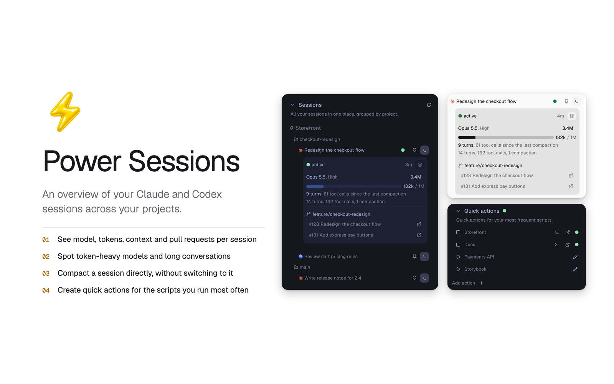
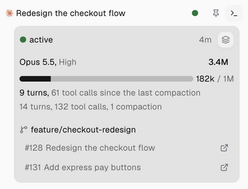
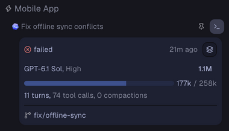
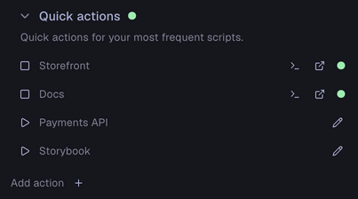
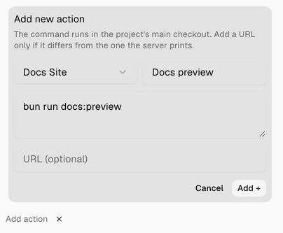

# Power Sessions

See every Claude and Codex session across your Orca projects in one side panel. Check what each
agent is doing and how much it has used, compact a long conversation, and run your dev scripts.



## Features

- **See every session.** Claude and Codex sessions, grouped by project. A green dot marks an agent that is working.
- **Check a session at a glance.** Status, model and reasoning effort, tokens, context, turns, tool calls and compactions, where available.
- **Recognise model and turn warnings.** Fable and Astra model names show in the warning colour, as do long conversations.
- **Follow the work.** Session details show the workspace branch and linked pull requests, which open in your browser.
- **Compact in one press.** Compact a conversation without switching to it.
- **Jump to a session.** Open any session’s tab straight from the list.
- **Run your scripts.** Quick actions start and stop a dev server, show its terminal and open its URL.

| Session details | Compact |
| --- | --- |
|  |  |

| Quick actions | Add an action |
| --- | --- |
|  |  |

More screenshots, in dark and light: [docs/features.md](docs/features.md).

## Get started

Requires **Orca 1.4.248+** with its CLI and `sqlite3`, on macOS. Pull request titles need **GitHub CLI (`gh`)**,
signed in with access to your repositories.

Install from GitHub with Orca’s CLI:

```sh
orca plugin install rr235/orca-power-sessions
```

Review the access request, then run the approval command Orca prints.

1. Open **Power Sessions**, the lightning-bolt panel in Orca’s right sidebar. Your projects and sessions appear on their own.
2. Click a session to expand or collapse its details. Press the terminal button beside it to show its tab. Click a project to open its main checkout.
3. Press **Compact** in the details to compact the conversation.
4. Press the pin beside a session to keep its details open under **Pinned**, above the list. Press it again to unpin.
5. Click **Sessions** or **Quick actions** to collapse or expand that section.

Power Sessions does not create sessions or worktrees. Open them in Orca as usual.

## Quick actions

1. Press the **+** beside **Add action**, below the session list.
2. Pick a project, then enter a name and a command, such as `bun run dev`.
3. Add a URL only if it differs from the one the server prints.
4. Press **Add +**, then the action’s **Run** button.

The command runs in the project’s main checkout. A green dot marks a running action. Its controls
show the tracked terminal, stop it by closing that terminal, and open the URL once known. Servers
started elsewhere have only the URL control. A stopped action has an edit button to change or delete it.

## Good to know

- **Compact runs right away.** It sends `/compact`, or its equivalent in a chat. The button is disabled while the agent is working; it does not queue a compact.
- **Turn colours.** Turns show in the warning colour above 20 and in red above 35, counted since the last compaction, or from the start before the first one.
- **Context size.** Capacity comes from the transcript or from Orca. For Claude, it falls back to an estimate for the model.
- **Orca internals.** Compacting a chat and showing a tab use internal Orca APIs, which can change between releases. Failures show in the panel.
- **Refresh.** While visible, the panel reloads every 15 seconds. Agent status changes and workspace creation or removal also trigger a reload. The refresh button beside **Sessions** collapses all details, except pinned ones, and reloads.

## What it reads and runs

Power Sessions runs code on your machine, so Orca asks you to approve it. It:

- reads projects, workspaces, sessions and terminals with the Orca CLI
- reads local Claude and Codex transcripts, Orca’s hook status file and its session database
- looks up pull requests with `gh`, signed in as you
- runs and closes quick-action terminals, reads their output and checks local ports
- opens URLs and pull requests in your browser when you press their controls

## Development

```sh
orca plugin validate .
orca plugin test .
orca plugin check .
orca plugin dev load .
```

Two scripts redraw generated images. Both need Google Chrome.

- `bun scripts/icons.ts` draws the [Lucide](https://lucide.dev/icons) icons in `assets/details/`, under the [ISC licence](assets/details/LICENSE).
- `bun scripts/plugin-page.ts` draws the plugin page screenshots in `assets/plugin-page/` from the captures in `assets/screenshots/`.

Agent icons in `assets/agents/` use Orca’s Claude mark and the Codex mark from the Codex desktop
app (`ChatGPT.app`).

## License

[MIT](LICENSE). The Lucide icons keep their ISC licence, and the agent marks belong to their owners.
