# Power Sessions features

An overview of your Claude and Codex sessions across your projects.
The project, workspace and session Orca shows are in normal text, the rest muted.

| Dark | Light |
| --- | --- |
| 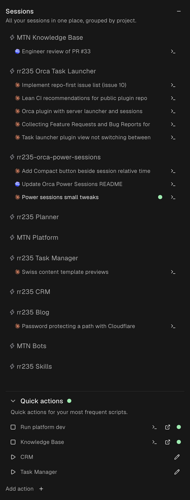 | 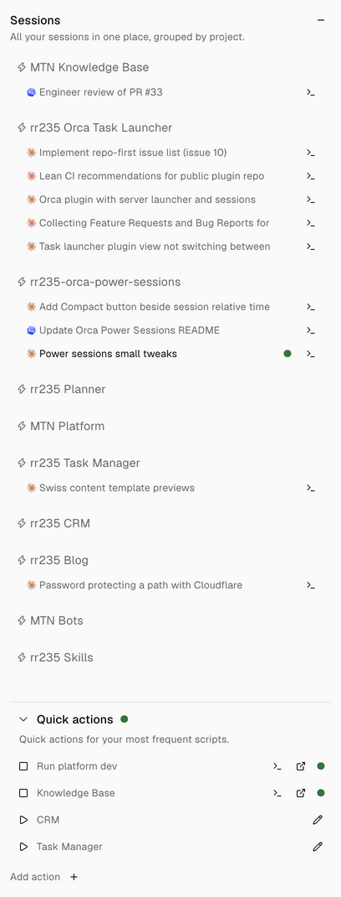 |

## Features

### Session details

Open any session to see what it is doing and how much it has used.
Usage appears where recorded by Claude, Codex or Orca.

- **Model and effort**: the latest recorded model and reasoning effort, where available. Fable and Astra model names show in the warning colour.
- **Tokens**: the total tokens the session has used.
- **Context**: how full the context window is, as used and total size.
- **Turns and tool calls**: your prompts and the agent's tool calls, since the last compaction and in total. More than 20 turns since the last compaction show in the warning colour, more than 35 in red. Before the first compaction, the colours apply to total turns.
- **Compactions**: how often the conversation has been compacted.
- **Branch**: the workspace’s current Git branch.
- **Pull requests**: pull requests linked to the session’s tab or shared by its workspace. Each one opens in your browser.

| Dark | Light |
| --- | --- |
| 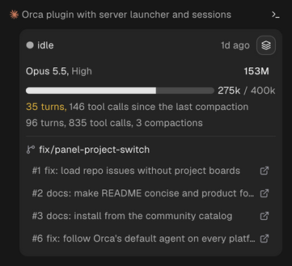 | 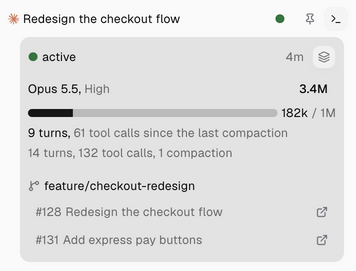 |

| Dark | Light |
| --- | --- |
| 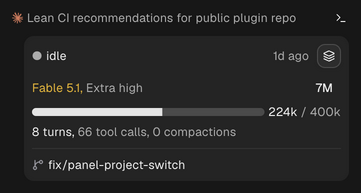 | 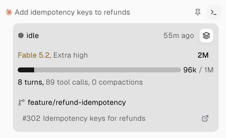 |

### Compact your sessions directly

Press **Compact** in a session's details to compact its conversation without switching to it. The button is disabled while the agent is working; it does not queue a compact.

> **Use with caution.** Pressing Compact runs `/compact`, or its equivalent, in the session right away.

| Dark | Light |
| --- | --- |
| 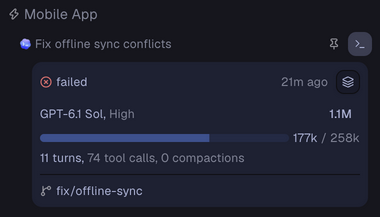 | 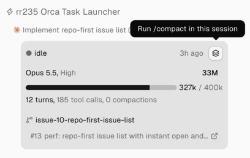 |

### Quick actions

Create quick actions for the scripts you run often in your projects, such as a dev server.

- **Run and stop**: start a script with one press. Stop closes its tracked terminal. A server started elsewhere has no Stop control.
- **Running at a glance**: a green dot marks each running action, and one beside the section title shows that something is running.
- **Terminal and URL**: show the action’s tracked terminal, or open its URL in your browser once known.
- **Edit**: change an action's project, name, command or URL.

| Dark | Light |
| --- | --- |
| 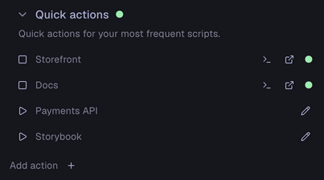 | 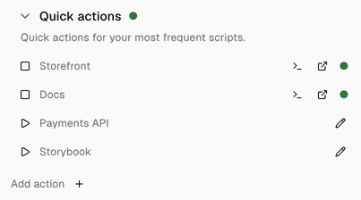 |

To add one, press the **+** beside **Add action**, pick the project, then give it a name and the command. Add a URL only if it differs from the one the server prints. Press **Add +** to save it. The command runs in the project’s main checkout.

| Dark | Light |
| --- | --- |
| 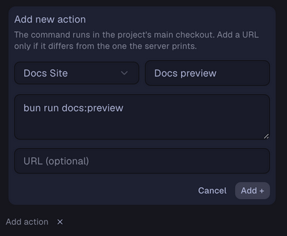 | 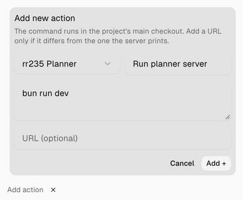 |
